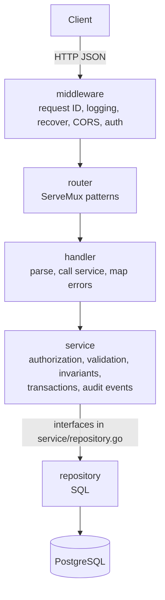

# Architecture (low-level design)

## 1. Responsibilities

The directory owns identity and collaboration metadata:

- **Peers**: one per third-party identity (Google), with a unique handle.
- **Rooms**: a workspace holding documents and members. A room is PUBLIC
  (anyone may join) or PRIVATE (invite-only).
- **Membership and roles**: a room role per member (OWNER, PARTICIPANT) and
  optional per-document roles (DOC_OWNER, EDITOR, VIEWER).
- **Document references**: title, order and provenance of each document. The
  content lives elsewhere.
- **Invites, bans, and an append-only audit log per room.**

Out of scope: document content, real-time sync, presence and comments. Those
belong to the collaboration server (not built yet).

## 2. Layers

| Layer | Package | Rule |
|---|---|---|
| Middleware | `middleware` | Cross-cutting only. `Authenticate` puts the caller's peer ID in the request context. |
| Router | `router` | Maps `METHOD /path` patterns to handlers. Authenticated routes live under `/api/v1`. Handlers are defined as interfaces here, so the router does not import the handler package. |
| Handler | `handler` | Translation only: decode JSON (1 MiB limit, unknown fields rejected), parse path IDs, call one service method, encode the result or map the error. No business rules. |
| Service | `service` | All business rules. Depends only on the repository interfaces it defines, never on SQL. |
| Repository | `repository` | Implements the interfaces with `database/sql`. Translates driver errors into service errors. The only place that builds models from rows (`scan.go`). |
| Model | `model` | The JSON shapes the API returns. |

The repository interfaces are declared in the **service** package (the
consumer), not in the repository package. That is what lets the service tests
run against an in-memory store (`service_test/memstore_test.go`) and the
Postgres repositories implement the same contract.

## 3. Request lifecycle

Example: `POST /api/v1/rooms/{roomId}/invites`.

1. `RequestID` reads or creates `X-Request-ID`; `Logging` logs the request;
   `Recover` turns a panic into a 500; `CORS` answers preflights.
2. `Authenticate` reads the token from `Authorization: Bearer …` or the
   `session` cookie, verifies it and stores the peer ID in the context. Missing
   or invalid token (bad signature, expired, revoked): 401. Any other
   verification error means the session store failed and gets 503, so an
   outage does not look like a forced logout. A `TokenVerifier` signals a bad
   token by returning an error that wraps `middleware.ErrInvalidToken`;
   `auth.ErrInvalidToken` and `auth.ErrTokenRevoked` both do.
3. The router matches `POST /api/v1/rooms/{roomId}/invites` and calls
   `InviteHandler.Create`.
4. The handler parses `{roomId}` and the body, then calls
   `InviteService.Create(ctx, actor, roomID, inviteeID)`.
5. The service opens a transaction (`Store.WithTx`), locks the room row, checks
   every rule, writes the invite and an `INVITE_CREATED` event, and commits.
6. The handler writes `201` with the invite and its link, or maps the error
   (section 6).

## 4. Transactions and locking

`Store.WithTx(ctx, fn)` runs `fn` with repositories bound to one transaction:
commit if `fn` returns nil, roll back on an error or a panic.

**Every write to a room starts by locking that room's row**
(`RoomRepository.LockForUpdate`, `SELECT … FOR NO KEY UPDATE`). This
serializes all writers of one room, which is what makes these rules safe under
concurrency:

- the last-owner rule (two owners cannot both step down at once);
- single-use invites (two tabs accepting the same invite: one wins);
- one pending invite per person (concurrent invites share one row);
- gapless per-room event IDs.

`FOR NO KEY UPDATE` rather than `FOR UPDATE` because the room's key never
changes; it still conflicts with other writers and with `DELETE`, but does not
block the foreign-key checks other transactions run against the room.

The database adds a second line of defence for the most important invariants:
unique indexes (one pending invite per room and invitee, unique handles, unique
invite codes) and conditional updates (`Resolve` only changes an invite whose
status is still `PENDING`).

Reads that need no consistency across tables run outside a transaction.

## 5. Authorization

| Rule | Where |
|---|---|
| Any signed-in peer may create rooms, discover public rooms, join public rooms, read their invite inbox | service |
| **Members** may read the room, its documents, members and events; create and clone documents; invite people to a private room; leave | `requireMember` |
| **Room OWNER** may rename, change visibility and default doc role, delete the room, change room roles, remove others, ban and unban | `requireOwner` |
| **Document manager** (the document's DOC_OWNER, or a room OWNER) may rename, reorder and delete the document and change doc roles on it | `requireDocManager` |
| An invite's **inviter or a room OWNER** may revoke it; only its **invitee** may see, accept or decline it | `InviteService` |
| A room must always keep at least one OWNER | `ensureAnotherOwner` |

A non-member asking about a room gets **404, not 403**, so outsiders cannot
probe which rooms exist. The same applies to invite codes: anyone but the
invitee gets 404.

## 6. Errors

Services return wrapped sentinel errors; handlers map them with `errors.Is`:

| Service error | HTTP | Typical cause |
|---|---|---|
| `ErrValidation` | 400 | Bad input: empty name, bad handle, search too short |
| `ErrNotFound` | 404 | Missing row, or a resource the caller may not know exists |
| `ErrForbidden` | 403 | Member lacks the role; banned peer joining |
| `ErrConflict` | 409 | Duplicate, last-owner rule, invite no longer pending, public room has no invites |
| `ErrRateLimited` | 429 | More than 30 invites in an hour |
| `context.Canceled` | 499 | Client disconnected (logs only) |
| anything else | 500 | Logged with the request ID; the client gets a generic message |

The repository maps `sql.ErrNoRows` to `ErrNotFound` and Postgres unique
violations (`23505`) to `ErrConflict`. Foreign-key and check violations are
returned as-is: they signal a bug, not a user error.

Error responses are always `{"error": "message"}`.

## 7. Audit events

Every successful state change in a room appends a `RoomEvent` **in the same
transaction**, so the log can never disagree with the data.

- IDs are per room and gapless: `rooms.last_event_id` is incremented and read
  in the same statement that inserts the event (`appendEventSQL`).
- Clients sync with `GET /rooms/{id}/events?after={lastSeen}`.
- `actorId` is who did it; `targetId` / `targetDocId` are the affected peer or
  document (zero UUID when not applicable); `details` is JSON.

| Event | Written by | Notable details |
|---|---|---|
| `ROOM_CREATED` | Rooms.Create | name, visibility, defaultDocRole |
| `RENAME_ROOM` | Rooms.Update | oldName, newName |
| `CREATE_DOC`, `CLONE_DOC`, `RENAME_DOC`, `DELETE_DOC` | Documents | title, positionRank, clonedFrom |
| `ADD_MEMBER` | invite accept, public join | via (`invite` or `join`), inviteId, roomRole |
| `REMOVE_MEMBER` | Members.Remove | roomRole |
| `UPDATE_ROOM_ROLE`, `UPDATE_DOC_ROLE` | Members | oldRole, newRole (effective old role for docs) |
| `INVITE_CREATED`, `INVITE_DECLINED`, `INVITE_REVOKED` | Invites, Rooms.Update | inviteId, reason (`revoked` or `room_public`) |
| `BAN_MEMBER`, `UNBAN_MEMBER` | Members.Ban/Unban | wasMember, revokedInvites |

Deleting a room deletes its log (cascade), so `Rooms.Delete` writes no event.

## 8. Identity and sessions

- Sign-in is OAuth 2.0 with Google (`oauth.GoogleAdapter`). A CSRF `state`
  value is stored in a short-lived cookie and checked on the callback.
- The first sign-in with an identity creates the peer (sign-up), with a handle
  generated from the display name. Later sign-ins return the same peer.
- Sessions are HS256 JWTs (`auth.JWTSessionManager`) with claims `peer_id`,
  `sub`, `jti`, `iat`, `exp`; lifetime `auth.jwtDuration` (24h). The token is
  set as the `session` cookie and is also accepted as a bearer token.
- Logout adds the token to an in-memory revocation list (see
  [roadmap.md](roadmap.md#known-issues)).

## 9. Time and IDs

The service layer, not the database, generates every ID (`uuid.New`), invite
code (128 random bits from `crypto/rand`, base64url) and timestamp. They are
fields on the shared `base` struct so tests can control them;
`service.WithClock` replaces the clock (used to test invite expiry and rate
limits).

## 10. Testing strategy

| Suite | Runs against | Proves |
|---|---|---|
| `service_test` | in-memory store with rollback | business rules, authorization, event order |
| `handler` (auth) | fake provider and sessions | OAuth flow, cookies, error paths |
| `oauth` | fake Google over HTTP; opt-in live check | token exchange, userinfo, real credentials |
| `main` (config) | temp files and env | config precedence, validation |
| `repostiory_test` | real Postgres | SQL, constraints, cascades, concurrency, migrations |
| `repostiory_test/api_test.go` | real router, handlers, JWTs, Postgres | HTTP status codes, routing, JSON shapes |

The Postgres suites only run when `TEST_DATABASE_URL` is set, because they
empty every table.
