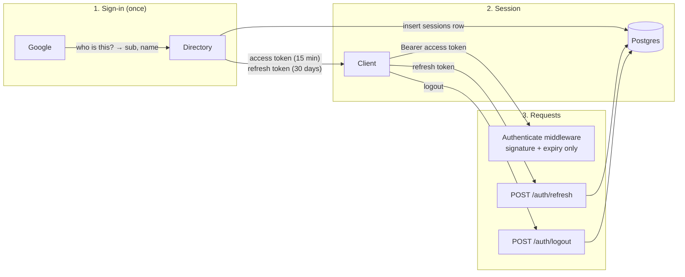
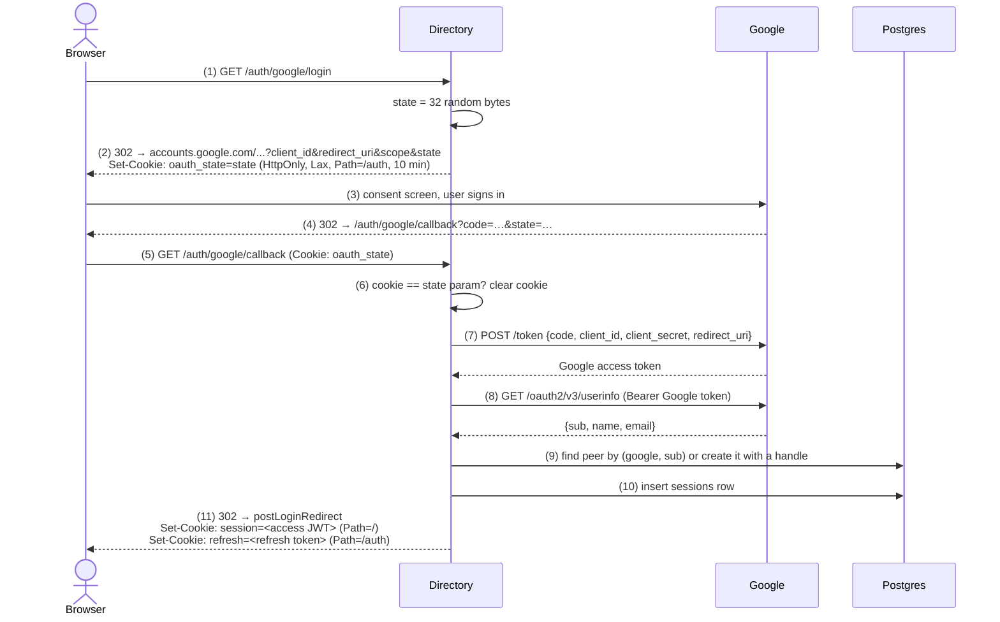
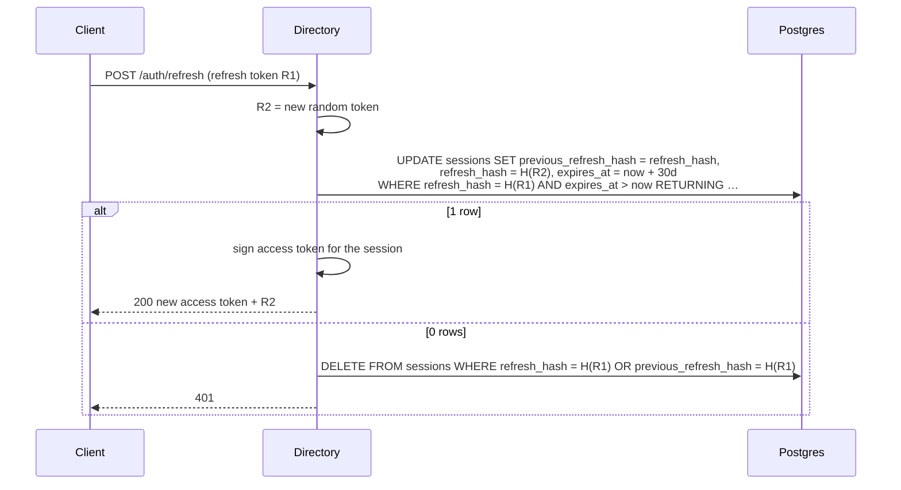

# Authentication

How a person proves who they are to the directory, from clicking "Sign in
with Google" to every later API call, refresh and logout. It covers the two
technologies involved, **OAuth 2.0** (sign-in) and **JWT** (sessions), the
reasons for each design choice, and where each step lives in the code.

Related: [api.md](api.md#sessions-refresh-and-logout) (endpoint reference),
[desktop-clients.md](desktop-clients.md) (web vs desktop clients),
[decisions.md](decisions.md#peers-and-identity) (P1–P18).

---

## 1. The big picture

Authentication has three phases:

1. **Sign-in (OAuth 2.0 with Google).** The directory never sees a password.
   Google confirms who the person is and gives the directory a stable user ID
   (`sub`). The directory finds or creates the matching peer.
2. **Session (JWT access token + refresh token).** The directory starts its
   own session and hands the client two tokens. From here on Google is not
   involved at all.
3. **Every request.** The client sends the access token; the middleware checks
   it without touching the database. When it expires, the client trades the
   refresh token for a new pair. Logout deletes the session.



### Who is who

| Party | Role in OAuth terms | Notes |
|---|---|---|
| The person | Resource owner | Owns the Google account |
| Browser or desktop app | User agent / client app | Holds the directory's tokens. Never holds a Google token |
| Directory | **OAuth client** (confidential) | Holds Google's client ID and client secret; the only party Google knows about |
| Google | Authorization server + identity provider | Authenticates the person, issues an authorization code, then tokens to the directory |
| Directory's own tokens | — | The directory is also its own "token issuer" for sessions; these have nothing to do with Google's tokens |

### Every credential in the system

| Credential | Issued by | Lifetime | Stored where | Used for |
|---|---|---|---|---|
| `oauth_state` cookie / `state` param | Directory | 10 min, single use | Browser cookie (Path `/auth`) | CSRF protection of the sign-in round trip |
| Google authorization code | Google | Seconds, single use | Only in the redirect URL | Directory trades it for Google tokens |
| Google access token | Google | ~1 h | Directory memory, for one request, then discarded | Reading the user's profile once |
| Desktop one-time code | Directory | 60 s, single use | SHA-256 in `desktop_auth_codes` | Desktop app trades it (with PKCE) for directory tokens |
| **Access token** (JWT) | Directory | `auth.jwtDuration`, 15 min | Browser: `session` cookie. Desktop: app memory | Authenticating API requests |
| **Refresh token** | Directory | `auth.sessionDuration`, 30 days, sliding | SHA-256 in `sessions`. Browser: `refresh` cookie. Desktop: OS keychain | Getting new access tokens; identifying the session at logout |

---

## 2. OAuth 2.0 sign-in

### 2.1 Why OAuth, and which flow

The directory does not store passwords (decision P1). OAuth 2.0 lets Google
do the authentication and tell the directory the result. Of OAuth's flows,
the **authorization code flow** (RFC 6749 §4.1) is the one for a server-side
client:

- The browser only ever carries a short-lived **code**, never a token.
- The directory exchanges the code for tokens over a direct, server-to-server
  HTTPS call, authenticated with its **client secret**. Someone who steals the
  code from the browser cannot redeem it without that secret.

Strictly, OAuth is for *authorization* (access to an API), not
*authentication*. The directory uses it for authentication the standard way:
it uses the Google access token once, to call Google's userinfo endpoint (an
OpenID Connect endpoint), and keeps only the stable `sub` identifier.

### 2.2 Configuration

`oauth.GoogleAdapter` ([oauth_provider_adapter.go](../internal/oauth/oauth_provider_adapter.go)),
built from config (`oauth.google.*`, see [operations.md](operations.md#configuration)):

| Setting | Value | Meaning |
|---|---|---|
| Client ID / secret | from Google Cloud Console | Identify the directory to Google. The secret never leaves the server |
| Redirect URL | `http://localhost:8080/auth/google/callback` | Must exactly match one registered in the Google console; Google refuses to redirect anywhere else |
| Scopes | `userinfo.profile`, `userinfo.email` | Enough to read `sub`, `name`, `email` |
| Endpoints | `golang.org/x/oauth2/google` | `accounts.google.com/o/oauth2/auth` (consent), `oauth2.googleapis.com/token` (exchange) |

Providers are registered in a map keyed by the `{provider}` path segment
(`google`), so a second provider is a new adapter implementing
`handler.OAuthProvider` (`AuthCodeURL`, `Exchange`) and no other change.

### 2.3 Browser sign-in, step by step



**(1)–(2) `AuthHandler.Login`.** Generates `state` with `crypto/rand` (256
bits), stores it in the `oauth_state` cookie and redirects to Google's consent
URL with that state. Cookie attributes: `HttpOnly` (no script access),
`SameSite=Lax` (so it is still sent when Google redirects back, which is a
top-level navigation), `Path=/auth`, `Max-Age` 10 minutes.

**(3)–(4) At Google.** The person signs in and consents. Google redirects
the browser to the registered redirect URL with `code` and the same `state`.
If they decline, Google sends `error=access_denied` instead.

**(5)–(6) `AuthHandler.Callback` → `checkState`.** The `state` query
parameter must equal the cookie (constant-time comparison). The cookie is
cleared whatever the outcome, so a state is single use. This defeats **login
CSRF**: without it, an attacker could make your browser complete a sign-in
with *their* code, silently signing you into *their* account, where anything
you create would belong to them. An attacker's page cannot read or set your
`oauth_state` cookie, so it cannot make the two match.

**(7)–(8) `GoogleAdapter.Exchange`.** A server-to-server POST to Google's
token endpoint with the code, client ID, **client secret** and redirect URI,
then a GET to the userinfo endpoint with the resulting Google access token.
The Google token is used for this one call and discarded; the directory
never stores or forwards Google tokens. The adapter requests **online access
only** (no `access_type=offline`), so Google issues no Google refresh token:
the directory never calls Google on the user's behalf after sign-in (decision
P19).

"Offline" in Google's sense means *the server acting while the user is away*,
not *the client having no network*. Clients that go offline rely on the
directory's own refresh token instead (§4.3): on reconnecting they refresh and
sync, and only sign in again after `auth.sessionDuration` without connecting.

**(9) `PeerService.FindOrCreateByAuth`.** Looks up the peer by
`(auth_provider, auth_subject)` = `("google", sub)`, unique in the `peers`
table. `sub` is used rather than email because emails can change and be
reassigned; `sub` never changes for a Google account. On first sign-in a peer
is created (sign-up) with a handle generated from the display name
(`Ada Lovelace` → `ada.lovelace`, with a numeric suffix if taken). If two
first sign-ins race, the loser of the unique constraint reuses the winner's
peer. A returning user's display name is not overwritten from Google.

**(10)–(11) Start the session.** See [§4](#4-sessions-refresh-tokens-and-logout).
The browser is redirected to `auth.postLoginRedirect` (the web app) with two
cookies set.

**Failures.**

| Situation | Browser gets |
|---|---|
| Unknown provider | 404 |
| State missing, mismatched or cookie expired | 400, no code exchanged |
| User declined at Google | 302 → `postLoginRedirect?auth_error=access_denied` |
| No `code` in the callback | 400 |
| Google exchange or userinfo failed, or no `sub` | 502 (logged with request ID) |
| Database error | 500 |

### 2.4 Desktop sign-in: OAuth for native apps with PKCE

A desktop app cannot use §2.3 unchanged: the sign-in happens in the system
browser, and a cookie set there never reaches the app. It also cannot be an
OAuth client itself, because an installed app cannot keep a client secret.
The directory therefore stays the only OAuth client and adds a second leg
between itself and the app, following **RFC 8252** (OAuth for native apps)
with **PKCE** (RFC 7636).

```mermaid
sequenceDiagram
    participant A as Desktop app
    participant L as App loopback listener
    participant B as System browser
    participant D as Directory
    participant G as Google
    A->>A: verifier = random(43–128 chars)<br/>challenge = base64url(SHA-256(verifier))
    A->>L: listen on 127.0.0.1:<random port>
    A->>B: open /auth/google/login?redirect_uri=http://127.0.0.1:port/cb<br/>&code_challenge&code_challenge_method=S256&state=appState
    B->>D: GET /auth/google/login?…
    D->>D: validate; store desktop_logins row keyed by the Google state
    D-->>B: 302 to Google (same as browser flow)
    Note over B,G: steps (3)–(9) of the browser flow
    D->>D: take desktop_logins row; issue one-time code (store SHA-256, 60 s)
    D-->>B: 302 http://127.0.0.1:port/cb?code=…&state=appState
    B->>L: GET /cb?code&state
    L->>A: code (app checks state == appState)
    A->>D: POST /auth/token {code, codeVerifier, redirectUri}
    D->>D: delete code row; SHA-256(verifier) == challenge? redirectUri matches?
    D->>D: start session (§4)
    D-->>A: {accessToken, expiresAt, refreshToken, refreshExpiresAt, peer}
```

What each piece defends against:

| Piece | Attack it stops |
|---|---|
| **PKCE** (`code_challenge` now, `code_verifier` at redemption) | Another program on the machine that sees the loopback redirect and grabs the code. The code is useless without the verifier, which never left the app. Only S256 is accepted; `plain` would put the secret in the browser URL |
| **Loopback redirect only** (`http://127.0.0.1:<port>` or `[::1]`, IP literal, explicit port, no query or fragment) | Open redirect: the directory can only ever send a code back to the user's own machine. `localhost` is refused because DNS or hosts files can point it elsewhere. Custom schemes are refused because any app can register them |
| **App `state`** echoed to the listener | A forged redirect reaching the listener; the app discards anything with the wrong state |
| **One-time code**: 256 bits, 60 s, deleted on first redemption even if the verifier is wrong, stored only as SHA-256 | Replay, guessing, and theft from the database |
| **Same 400 for every redemption failure** | Learning which part was wrong |

Code: `service.DesktopLoginService` (`Begin`, `Take`, `IssueCode`, `Redeem`),
`AuthHandler.Login` (desktop parameters), `AuthHandler.Callback` (desktop
branch, `redirectToApp`), `AuthHandler.Token`. Tables `desktop_logins` and
`desktop_auth_codes` (migration 11). Full client checklist:
[desktop-clients.md](desktop-clients.md#what-the-desktop-app-has-to-do).

---

## 3. JWT access tokens

### 3.1 What a JWT is

A JSON Web Token (RFC 7519) is three base64url-encoded parts joined by dots:

```
eyJhbGciOiJIUzI1NiIsInR5cCI6IkpXVCJ9 . eyJwZWVyX2lkIjoi…In0 . 3q2-7wLx…
          header                                payload             signature
```

Decoded, a directory access token looks like:

```json
// header
{"alg": "HS256", "typ": "JWT"}

// payload (claims)
{
  "peer_id": "6f1c2a9e-…",          // the peer this token authenticates
  "sid":     "b7d04e11-…",          // the session (row in `sessions`) it belongs to
  "sub":     "6f1c2a9e-…",          // standard "subject" claim, same peer ID
  "jti":     "0c9a7f3d-…",          // unique token ID
  "iat":     1792756800,            // issued at (Unix seconds)
  "exp":     1792757700             // expires at: iat + 15 min
}
```

The **signature** is `HMAC-SHA256(secret, base64url(header) + "." +
base64url(payload))`, keyed with `auth.jwtSecret`. Two consequences:

- **Anyone can read a JWT.** Base64url is encoding, not encryption. A token
  must contain nothing secret; ours holds only IDs and times.
- **No one can change or forge one without the secret.** Changing a single
  character of the payload invalidates the signature. That is why the server
  can trust `peer_id` without looking anything up.

HS256 is symmetric: the same secret signs and verifies. That fits because the
directory is the only party that issues and checks these tokens today. That
changes with peer-to-peer editing: peers will verify each other's
directory-issued tokens when they connect, and they must not be able to mint
them, so the plan is to switch to an asymmetric algorithm (Ed25519 / EdDSA,
public key for verifiers; decision C11, roadmap).

### 3.2 Issuing: `auth.AccessTokens.Issue`

([internal/auth/session.go](../internal/auth/session.go)) Takes the peer ID
and the session ID, fills the claims above with `exp = now + jwtDuration`,
and signs with HS256. Nothing is stored anywhere. Called by the handler right
after a session is started or refreshed (`startSession`, `accessFor`).

### 3.3 Verifying: `auth.AccessTokens.Verify`

Runs on every authenticated request. In order:

1. **Parse** the three parts and decode the header and payload.
2. **Check the algorithm** is exactly HS256 (`jwt.WithValidMethods`). This
   blocks two classic attacks: `"alg": "none"` (an unsigned token) and
   algorithm confusion (an RS256 public key reused as an HMAC secret).
3. **Check the signature** with `auth.jwtSecret`.
4. **Check `exp`** against the clock: expired is rejected.
5. **Check `peer_id` and `sid` are present.** A token without a session ID
   predates sessions and cannot be logged out, so it is refused.
6. Return `peer_id`.

Any failure returns an error wrapping `middleware.ErrInvalidToken`, which the
middleware turns into **401**. Note what is *not* in this list: no database
query. That is the property JWTs exist for, and the reason access tokens are
kept short (§3.5).

### 3.4 Reading the session of an expired token: `SessionID`

The same parsing, but with `jwt.WithoutClaimsValidation()`: the algorithm and
signature are still checked, the expiry is not. It returns `sid`. Used only by
logout, so a client whose access token expired a moment ago can still say
"end my session". A forged token still fails the signature check, so nobody
can name someone else's session.

### 3.5 The trade-off: why 15 minutes

A JWT cannot be withdrawn once issued: every server that knows the secret
will accept it until `exp`. The old design used 24-hour tokens and tried to
withdraw them with an in-memory list, which forgot logouts on restart and was
not shared between instances. The current design:

- keeps access tokens short (`auth.jwtDuration`, 15 min), so a token that
  outlives its logout does so for minutes;
- keeps the *session* in Postgres, where logout is a durable `DELETE` (§4).

| Approach | Lookup per request | Logout takes effect | Survives restart |
|---|---|---|---|
| Long JWT + in-memory denylist (old) | No | Immediately, on that instance only | No |
| **Short JWT + sessions in Postgres (current)** | No | Refresh: immediately. Access tokens already issued: within 15 min | Yes |
| Short JWT + denylist of `sid`s in Redis | Yes (Redis) | Immediately, everywhere | Yes (if Redis persists) |
| Opaque session ID looked up every request | Yes (database) | Immediately | Yes |

Decisions P13–P15 record why the second row was chosen and when to move to the
third.

---

## 4. Sessions, refresh tokens and logout

### 4.1 The session row

([0012_sessions.sql](../db/migrations/0012_sessions.sql),
`service.SessionService`, `repository.sessionRepo`)

| Column | Purpose |
|---|---|
| `session_id` | The `sid` in every access token of this session |
| `peer_id` | Owner; `ON DELETE CASCADE` from `peers` |
| `refresh_hash` | SHA-256 of the current refresh token (the token itself is never stored) |
| `previous_refresh_hash` | The token this one replaced, for reuse detection |
| `created_at`, `refreshed_at` | Bookkeeping |
| `expires_at` | `now + sessionDuration`, moved forward on every refresh |

One row per signed-in device. Signing in on a laptop and the desktop app
gives two rows and two independent sessions.

Why hash the refresh token: it is a 30-day bearer credential. With only its
SHA-256 stored, a leaked backup or a SQL injection yields nothing usable. A
plain hash (no salt, no slow KDF) is enough because the token is 256 random
bits; slow hashing exists to protect low-entropy passwords from guessing.

### 4.2 Starting a session: `SessionService.Start`

1. Generate a refresh token: 32 bytes from `crypto/rand`, base64url (43 chars).
2. Purge expired sessions (`DELETE … WHERE expires_at <= now`). This is the
   only cleanup; no background job is needed.
3. Insert the row with the token's hash and `expires_at = now + 30 days`.
4. Return the session ID and the plain token. The handler signs an access
   token for that session and sends both to the client. This is the only
   moment the plain refresh token exists on the server.

### 4.3 Refreshing: `POST /auth/refresh` → `SessionService.Refresh`



- **Rotation.** Every refresh returns a new refresh token and spends the old
  one. A stolen refresh token therefore only works until the next refresh by
  either party.
- **Atomic, single use.** The check and the swap are one `UPDATE`. Postgres
  row-locks the row; a concurrent second refresh with the same token waits,
  then re-evaluates the `WHERE` against the updated row, finds the hash
  changed and matches nothing. No explicit transaction is needed.
- **Reuse detection.** If the `UPDATE` matches nothing, the token is unknown,
  expired, or **already spent**. The follow-up `DELETE` matches a spent token
  through `previous_refresh_hash` and ends the session: if a spent token is
  presented, two parties had it, and the safe response is to sign both out
  (RFC 9700 §4.14). For unknown tokens it deletes nothing; for expired ones it
  cleans up early. The client gets the same 401 in every case.
- **Sliding expiry.** A successful refresh moves `expires_at` to 30 days from
  now, so someone who opens the app at least once a month never sees the
  sign-in screen again.
- **Errors other than "not found"** (database down) are 500, not 401, so an
  outage never looks like a forced logout.

**Client side.** Refresh shortly before `expiresAt` or on the first 401, and
only one refresh at a time: two concurrent refreshes with the same token look
exactly like theft and end the session.

**Browser vs desktop** (`AuthHandler.Refresh`, `refreshToken`):

| | Desktop | Browser |
|---|---|---|
| Sends | `{"refreshToken": "…"}` | No body; the `refresh` cookie |
| Receives | JSON with both new tokens | New `session` and `refresh` cookies; JSON with only `expiresAt` and `refreshExpiresAt` |
| On 401 | Delete the keychain entry, sign in again | Cookies cleared by the server; sign in again |

Browsers never receive tokens in a JSON body, so page JavaScript (and an XSS
bug) cannot read them.

### 4.4 Logout: `POST /auth/logout`

The route is **public** (no valid access token required), because a client
whose token just expired must still be able to log out. `AuthHandler.Logout`
looks for the session in this order:

1. A refresh token in the JSON body (desktop) or the `refresh` cookie
   (browser): `DELETE … WHERE refresh_hash = H(t) OR previous_refresh_hash = H(t)`.
2. Otherwise an access token (header or `session` cookie), even an expired
   one: `SessionID` → `DELETE … WHERE session_id = sid`.
3. Otherwise, or if the access token's signature is invalid: nothing to end.

Then it clears both cookies and returns **204**. Unknown or already-ended
sessions are also 204 (idempotent). If the database cannot be reached it
returns **503 and keeps the cookies**, so the client never believes it is
logged out while the session is still live.

**What happens after logout:**

| Credential | State |
|---|---|
| The session's refresh token | Dead immediately, on every instance, across restarts |
| Access tokens already issued for the session | Still accepted until their `exp` (at most 15 min) |
| Other sessions of the same person | Unaffected |

### 4.5 Sign out everywhere: `POST /auth/logout-all`

Requires a valid access token (it acts on "every session of *this* peer").
Deletes every `sessions` row of the caller and clears this client's cookies.
Every other device fails its next refresh and returns to the sign-in screen;
their access tokens lapse within 15 minutes.

---

## 5. Authenticating each request

`middleware.Authenticate` wraps every route under `/api/v1` and
`/auth/logout-all` ([internal/middleware/auth.go](../internal/middleware/auth.go)).

1. **Find the token** (`TokenFromRequest`):
   - `Authorization: Bearer <token>` if the header is present;
   - a present but malformed `Authorization` header is a failure: it does
     **not** fall back to the cookie, so a client bug is not masked;
   - otherwise the `session` cookie.
2. **No token** → 401 `missing credentials`.
3. **Verify** with `AccessTokens.Verify` (§3.3).
   - Error wrapping `ErrInvalidToken` → 401 `invalid or expired session`, with
     `WWW-Authenticate: Bearer`.
   - Any other error → 503 (a verifier backed by a store could fail; ours
     cannot, but the contract keeps an outage from looking like a logout).
4. **Success** → the peer ID goes into the request context
   (`middleware.WithPeerID`); handlers read it with `actorID`, and every
   service call receives it as `actor` for authorization checks.

Public routes (no middleware): `/healthz`, `/auth/{provider}/login`,
`/auth/{provider}/callback`, `/auth/token`, `/auth/refresh`, `/auth/logout`.

Authentication answers *who* is calling. Whether they may touch a given room
or document is *authorization*, done in the service layer
([architecture.md](architecture.md#5-authorization)).

---

## 6. Cookies, CORS and CSRF (browser only)

Desktop apps use bearer headers and none of this applies to them.

| Cookie | Value | Path | Lifetime | Attributes |
|---|---|---|---|---|
| `oauth_state` | Sign-in state | `/auth` | 10 min | HttpOnly, SameSite=Lax, Secure when `auth.cookieSecure` |
| `session` | Access JWT | `/` | 15 min | HttpOnly, SameSite=Lax, Secure when configured |
| `refresh` | Refresh token | `/auth` | 30 days | HttpOnly, SameSite=Lax, Secure when configured |

- **HttpOnly** on all three: page scripts cannot read them, so an XSS bug
  cannot steal them.
- **`Path=/auth` on `refresh`**: the browser sends it only to `/auth/refresh`
  and `/auth/logout`, never with ordinary API calls, which limits where it can
  leak (logs, proxies).
- **`Secure`**: set `auth.cookieSecure = true` in production (HTTPS), or the
  cookies travel in clear text.
- **CSRF.** Cookies are attached automatically, so another site could try to
  make the browser send them. `SameSite=Lax` stops cookies on cross-site
  POST, PUT, PATCH and DELETE, which covers every state-changing route.
  Note that "site" ignores ports: `localhost:3000` and `localhost:8080` are
  the same site, which is what lets the dev web app use these cookies.
- **CORS.** The web app's JavaScript runs on a different origin from the API,
  so the browser only lets it read responses if `server.allowedOrigins` lists
  that origin. Credentials (cookies) are allowed, which is why a wildcard
  origin is refused at startup.

---

## 7. Lifetimes and configuration

| Setting | Default | Effect |
|---|---|---|
| `auth.jwtSecret` / `JWT_SECRET` | none: **required** | HMAC key for access tokens. Empty stops startup (an empty key makes tokens forgeable). Changing it invalidates every access token at once; refresh tokens keep working, so clients recover on their next refresh |
| `auth.jwtDuration` | `15m` | Access token lifetime, and the longest an access token outlives its logout |
| `auth.sessionDuration` | `720h` (30 days) | Refresh token lifetime, extended on every refresh. Must be longer than `jwtDuration` (checked at startup) |
| `auth.cookieSecure` | `false` | Set `true` behind HTTPS |
| `auth.postLoginRedirect` | `http://localhost:3000/` | Where a browser lands after sign-in |
| `oauth.google.*` | — | Client ID and secret (required), redirect URL |
| Sign-in state | 10 min | Fixed (`stateTTL`, `desktopLoginTTL`) |
| Desktop one-time code | 60 s | Fixed (`desktopCodeTTL`) |

---

## 8. Threat model summary

| Threat | Defence |
|---|---|
| Password theft | No passwords: Google authenticates |
| Login CSRF (being signed into the attacker's account) | `oauth_state` cookie must match the `state` parameter |
| Stolen Google authorization code | Useless without the directory's client secret |
| Stolen desktop one-time code | PKCE verifier; 60 s; single use |
| Open redirect via `redirect_uri` | Loopback IP literals only |
| Forged or tampered access token | HMAC-SHA256 signature; algorithm pinned to HS256 |
| Stolen access token | Expires within 15 min; HttpOnly cookie in browsers, memory in the desktop app |
| Stolen refresh token | Rotation plus reuse detection end the session on the next use by either party; HttpOnly cookie scoped to `/auth`; OS keychain on desktop; logout and logout-all |
| Database leak | Refresh tokens and one-time codes stored only as SHA-256 |
| Logout forgotten after restart or on another instance | Logout deletes the Postgres row |
| XSS reading tokens | Browsers only ever get tokens in HttpOnly cookies |
| CSRF on API calls | SameSite=Lax cookies, explicit CORS origins; desktop uses bearer headers |
| Outage mistaken for logout | Store errors are 503/500, never 401 |

Known gaps: access tokens remain valid for up to 15 minutes after logout
(P15); there is no list of signed-in devices yet; no rate limiting on sign-in
or refresh ([roadmap.md](roadmap.md)).

---

## 9. Status codes at a glance

| Endpoint | Success | Failures |
|---|---|---|
| `GET /auth/{p}/login` | 302 to Google | 404 unknown provider; 400 bad desktop parameters |
| `GET /auth/{p}/callback` | 302 to web app (cookies) or to the app's loopback URI | 400 bad state / missing code; 502 Google failed; desktop errors go to the loopback URI as `error=` |
| `POST /auth/token` | 200 tokens + peer | 400 for any bad code, verifier or redirect URI |
| `POST /auth/refresh` | 200 | 401 unknown, expired, spent or missing token |
| `POST /auth/logout` | 204 (also when nothing to end) | 503 database unavailable (cookies kept) |
| `POST /auth/logout-all` | 204 | 401 no valid access token; 503 database unavailable |
| Any `/api/v1` route | — | 401 missing, invalid or expired access token |

---

## 10. Code map

| Concern | Where |
|---|---|
| Routes, public vs authenticated | `internal/router/peer-handler.go` (`registerAuthRoutes`), `router.go` |
| Sign-in, callback, token, refresh, logout handlers; cookies | `internal/handler/auth_handler.go` |
| Google adapter | `internal/oauth/oauth_provider_adapter.go` |
| Find or create peer, handles | `internal/service/peer_service.go` |
| Desktop sign-in rules (loopback, PKCE, codes) | `internal/service/desktop_login_service.go` |
| Sessions, rotation, reuse detection, logout | `internal/service/session_service.go` |
| Session SQL | `internal/repository/session_repo.go` |
| Access tokens (JWT) | `internal/auth/session.go` |
| Request authentication | `internal/middleware/auth.go` |
| CORS | `internal/middleware/cors.go` |
| Config and validation | `internal/main/config.go` |
| Tables | migrations `0011_desktop_login.sql`, `0012_sessions.sql` |
| Tests | `auth/*_test.go`, `handler/auth_*_test.go`, `service_test/session_test.go`, `service_test/desktop_login_test.go`, `repostiory_test/api_test.go` |

## 11. Standards referenced

| Spec | Used for |
|---|---|
| RFC 6749 | OAuth 2.0, authorization code flow, `state`, token responses |
| RFC 7636 | PKCE (S256) |
| RFC 8252 | OAuth for native apps: system browser, loopback redirect |
| RFC 9700 | OAuth security best current practice: refresh token rotation and reuse detection |
| RFC 7519 | JSON Web Token |
| RFC 6750 | Bearer tokens, `WWW-Authenticate: Bearer` |
| RFC 6265bis | Cookies, `SameSite` |
