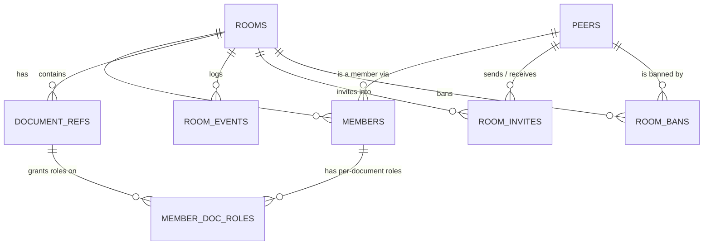

# Data model

## Relationships

Deleting a room cascades to its documents, members, per-document roles,
events, invites and bans.

## Models (JSON shapes)

### Peer

| Field | Type | Notes |
|---|---|---|
| `peerId` | UUID | |
| `handle` | string | Unique, lowercase, `^[a-z0-9._]{2,32}$`. How people find each other |
| `userName` | string | Display name, 1–64 characters, not unique |
| `AuthProvider`, `AuthSubject` | — | Never serialized (`json:"-"`), so other members cannot see the external identity |

`PeerRef` (`peerId`, `handle`, `userName`) is the public face of a peer,
embedded in invites, bans and search results.

### Room

| Field | Type | Notes |
|---|---|---|
| `roomId` | UUID | |
| `name` | string | 1–100 characters |
| `createdAt` | timestamp | UTC |
| `visibility` | `PUBLIC` \| `PRIVATE` | Default PRIVATE. PUBLIC: anyone may join. PRIVATE: invite-only |
| `defaultDocRole` | `EDITOR` \| `VIEWER` | Role a member has on a document with no explicit role. Default VIEWER; DOC_OWNER is never a default |

`RoomSummary` (`roomId`, `name`, `visibility`, `memberCount`, `isMember`) is
what non-members see of a public room.

### Member

| Field | Type | Notes |
|---|---|---|
| `peerId` | UUID | |
| `roomRole` | `OWNER` \| `PARTICIPANT` | A room always has at least one OWNER |
| `docRoles` | map docId → `DOC_OWNER` \| `EDITOR` \| `VIEWER` | Explicit roles only; missing means `defaultDocRole` |
| `invitedBy` | UUID | Zero UUID for the room creator and for public joins |
| `joinedAt` | timestamp | |

### DocumentRef

| Field | Type | Notes |
|---|---|---|
| `docId` | UUID | |
| `title` | string | 1–200 characters |
| `positionRank` | string | Fractional index chosen by the client, ≤128 bytes, compared byte-wise |
| `addedByPeer` | UUID | Creator, who becomes the document's DOC_OWNER |
| `addedAt` | timestamp | |
| `clonedFrom` | UUID, optional | Source document of a clone (no foreign key, so the clone survives the source being deleted) |

### RoomEvent

`roomId`, `eventId` (per-room sequence), `actorId`, `targetId`, `targetDocId`,
`eventType`, `details` (JSON), `timestamp`. See
[architecture.md](architecture.md#7-audit-events) for the event types.

### RoomInvite

| Field | Type | Notes |
|---|---|---|
| `inviteId` | UUID | |
| `code` | string | 22 URL-safe characters (128 random bits); the token in the invite link |
| `roomId`, `roomName` | | |
| `inviter`, `invitee` | PeerRef | |
| `roomRole` | `PARTICIPANT` | Invites never grant OWNER |
| `status` | `PENDING` \| `ACCEPTED` \| `DECLINED` \| `REVOKED` \| `EXPIRED` | |
| `createdAt`, `expiresAt` | timestamp | Expires 7 days after creation |
| `respondedAt` | timestamp, optional | When it left PENDING |

API responses add `url`: the configured link base plus the code.

### InviteCandidate

A `PeerRef` plus `status`: `AVAILABLE`, `MEMBER`, `INVITED` (live pending
invite), or `BANNED`.

### RoomBan

`peer` (PeerRef), `bannedBy` (UUID), `bannedAt`.

## Tables

### peers
| Column | Type | Constraints |
|---|---|---|
| peer_id | UUID | PK |
| handle | TEXT | NOT NULL, UNIQUE, CHECK `^[a-z0-9._]{2,32}$` |
| user_name | TEXT | NOT NULL |
| auth_provider, auth_subject | TEXT | NOT NULL, UNIQUE together (one peer per external identity) |

Indexes: `handle text_pattern_ops`, `lower(user_name) text_pattern_ops` (prefix search).

### rooms
| Column | Type | Constraints |
|---|---|---|
| room_id | UUID | PK |
| name | TEXT | NOT NULL |
| created_at | TIMESTAMPTZ | NOT NULL |
| visibility | TEXT | CHECK PUBLIC/PRIVATE |
| default_doc_role | TEXT | CHECK EDITOR/VIEWER |
| last_event_id | BIGINT | Per-room event counter |

Index: `lower(name) text_pattern_ops WHERE visibility = 'PUBLIC'` (discovery).

### document_refs
`doc_id` PK; `room_id` FK cascade; `title`; `position_rank TEXT COLLATE "C"`
(byte-wise order, which fractional indexing needs); `added_by` FK peers;
`added_at`; `cloned_from_doc_id` (no FK). `UNIQUE (room_id, doc_id)` lets child
tables use a composite FK. Index `(room_id, position_rank)`.

### members
PK `(room_id, peer_id)`; `room_role` CHECK OWNER/PARTICIPANT; `joined_at`;
`invited_by` FK peers, NULL for creators and public joins. Index on `peer_id`.

### member_doc_roles
PK `(doc_id, peer_id)`; `doc_role` CHECK DOC_OWNER/EDITOR/VIEWER. Two composite
FKs, `(room_id, peer_id)` → members and `(room_id, doc_id)` → document_refs,
both cascading, guarantee the member and the document are in the same room.

### room_events
PK `(room_id, event_id)`; `actor_id` FK peers; `target_id`, `target_doc_id`
without FKs (the log must outlive removed members and documents);
`event_type` CHECK list; `details JSONB`; `occurred_at`.

### room_invites
| Column | Type | Constraints |
|---|---|---|
| invite_id | UUID | PK |
| code | TEXT | UNIQUE |
| room_id | UUID | FK cascade |
| inviter_id, invitee_id | UUID | FK peers |
| room_role | TEXT | CHECK PARTICIPANT |
| status | TEXT | CHECK the five statuses |
| created_at, expires_at, responded_at | TIMESTAMPTZ | |

Indexes: partial UNIQUE `(room_id, invitee_id) WHERE status = 'PENDING'` (one
live invite per person and room); `(invitee_id, created_at) WHERE PENDING`
(inbox); `(inviter_id, created_at)` (rate limit).

An invite past `expires_at` keeps `status = PENDING` in the table until that
person is invited again; the service reports it as EXPIRED on every read.

### room_bans
PK `(room_id, peer_id)`; `banned_by` FK peers; `banned_at`.

### schema_migrations
`version` PK, `name`, `applied_at`. Written by the migration runner.

## Migration history

| Version | File | Change |
|---|---|---|
| 1 | `0001_peers.sql` | peers |
| 2 | `0002_rooms.sql` | rooms |
| 3 | `0003_document_refs.sql` | document_refs |
| 4 | `0004_members.sql` | members, member_doc_roles |
| 5 | `0005_room_events.sql` | room_events |
| 6 | `0006_peer_handles.sql` | peers.handle (backfilled), prefix-search indexes |
| 7 | `0007_public_room_search.sql` | public room name index |
| 8 | `0008_room_bans.sql` | room_bans |
| 9 | `0009_room_invites.sql` | room_invites |
| 10 | `0010_invite_and_ban_events.sql` | new event types in the room_events CHECK |

Migrations 1–5 use `IF NOT EXISTS` because they predate the migration runner
and had to be adopted by databases that already had the tables.
