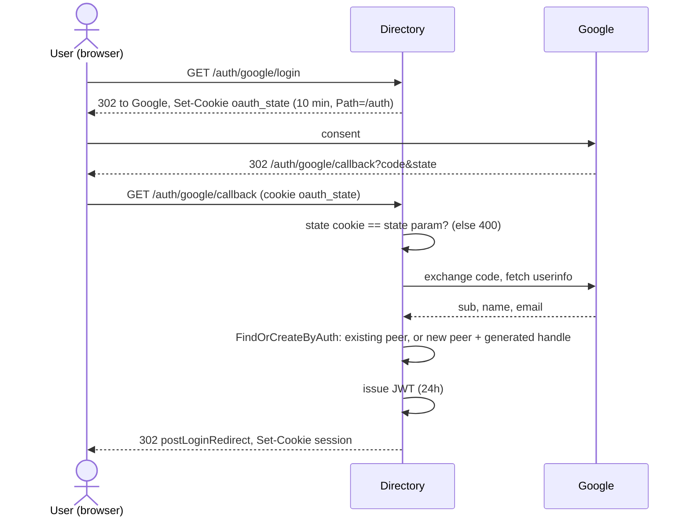

# Flows

## Sign-in (and sign-up)



The handle is generated from the display name (`Ada Lovelace` →
`ada.lovelace`); if taken, a 4-digit suffix is tried (`ada.lovelace_4821`), up
to 8 attempts. A name with no usable characters becomes `user_NNNN`. If two
first sign-ins race, the loser reuses the winner's peer.

## Joining a private room by invite

```mermaid
sequenceDiagram
    actor A as Alice (member)
    participant D as Directory
    actor B as Bob
    A->>D: GET /rooms/{id}/invite-candidates?q=bo
    D-->>A: [{bob, status: AVAILABLE}]
    A->>D: POST /rooms/{id}/invites {inviteePeerId: bob}
    Note over D: lock room; Alice is a member; room is PRIVATE;<br/>Bob exists, is not a member, not banned;<br/>no live pending invite; under 30/hour
    D-->>A: 201 {code, url, expiresAt}
    B->>D: GET /invites (inbox, polled for now)
    D-->>B: [{roomName, inviter: alice, url}]
    B->>D: GET /invites/{code} (preview)
    B->>D: POST /invites/{code}/accept
    Note over D: lock room; re-read invite: still PENDING, not expired;<br/>Bob not banned; add PARTICIPANT, invitedBy = Alice;<br/>ADD_MEMBER (via invite); status ACCEPTED
    D-->>B: 200 {room, member}
```

Other outcomes: Bob declines (`INVITE_DECLINED`), Alice or an owner revokes
(`INVITE_REVOKED`), the invite expires after 7 days, or the room is made public
(every pending invite revoked with reason `room_public`). In all of these a
fresh invite can be created afterwards.

## Joining a public room

```mermaid
sequenceDiagram
    actor B as Bob
    participant D as Directory
    B->>D: GET /rooms/discover?q=town
    D-->>B: [{roomId, name, memberCount, isMember: false}]
    B->>D: GET /rooms/{id}/preview
    B->>D: POST /rooms/{id}/join
    Note over D: lock room; already a member? -> 200 no-op;<br/>PRIVATE -> 404; banned -> 403;<br/>add PARTICIPANT; ADD_MEMBER (via join)
    D-->>B: 201 member
```

## Banning

```mermaid
sequenceDiagram
    actor O as Owner
    participant D as Directory
    O->>D: PUT /rooms/{id}/bans/{peerId}
    Note over D: lock room; caller is OWNER; target is not self,<br/>exists, not already banned, not an OWNER;<br/>remove membership if any; revoke their pending invites;<br/>insert ban; BAN_MEMBER {wasMember, revokedInvites}
    D-->>O: 204
    O->>D: DELETE /rooms/{id}/bans/{peerId}
    D-->>O: 204 (UNBAN_MEMBER); the peer may join or be invited again
```

Leaving a room never bans you. In a public room, removing a member without
banning lets them rejoin immediately.
