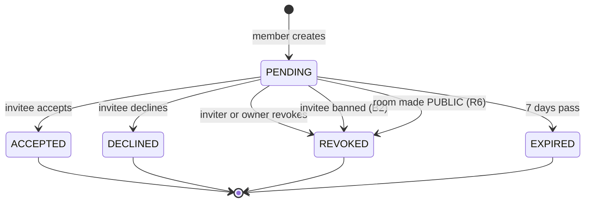

# Invites

How people get into a room: invitations for **private** rooms, direct joins
for **public** rooms, and how bans, visibility changes and expiry interact
with both. Covers the rules, every endpoint, the invite's lifecycle, the
database design, concurrency, and what a client has to do.

Related: [api.md](api.md#invites-private-rooms) (endpoint reference),
[flows.md](flows.md#joining-a-private-room-by-invite) (short sequence
diagrams), [decisions.md](decisions.md#invites) (R1–R8, I1–I12, B1–B5),
[authentication.md](authentication.md) (how callers are identified).

---

## 1. How someone gets into a room

A room's **visibility** decides the only way in (decision R3):

| Visibility | How you get in | Invites? | Discoverable? |
|---|---|---|---|
| `PRIVATE` (default) | A member invites you, you accept | Yes | No; outsiders get 404 for everything about it |
| `PUBLIC` | You join it yourself: `POST /rooms/{id}/join` | **No**; invite endpoints answer 409 | Yes, by name prefix: `GET /rooms/discover?q=` |

There is no third way: the old "owner adds a member directly" endpoint was
removed (R5). The person who creates a room is its first OWNER; everyone who
arrives by invite or join starts as a **PARTICIPANT** and can be promoted by
an owner afterwards (I4).

Bans apply to both: a banned peer can be neither invited nor join (B1–B2).

---

## 2. The private-room invite flow

The model is Discord's: a member searches for a person, sends them an invite,
and the person accepts or declines from their inbox or from a link.

```mermaid
sequenceDiagram
    actor A as Alice (member)
    participant D as Directory
    participant P as Postgres
    actor B as Bob
    A->>D: (1) GET /rooms/{id}/invite-candidates?q=bo
    D-->>A: [{bob, status: AVAILABLE}, {bobby, status: MEMBER}]
    A->>D: (2) POST /rooms/{id}/invites {inviteePeerId: bob}
    D->>P: lock room; checks; insert invite; INVITE_CREATED
    D-->>A: 201 {invite, url, appUrl}
    A-->>B: (3) send the link (chat, email) — optional
    B->>D: (4) GET /invites  (inbox)  or  GET /invites/{code}
    D-->>B: pending invite(s) with room name and inviter
    B->>D: (5) POST /invites/{code}/accept
    D->>P: lock room; re-check; add member (PARTICIPANT, invitedBy=Alice);<br/>ADD_MEMBER {via: invite}; mark ACCEPTED
    D-->>B: 200 {room, member}
```

### Step 1: find the person — `GET /rooms/{roomId}/invite-candidates?q=`

`InviteService.Candidates`. The caller must be a member (otherwise 404) and
the room must be private (otherwise 409).

- The query is trimmed, lower-cased, and a leading `@` is dropped, so
  `@Ada` and `ada` are the same search. It must be 2–64 characters.
- It matches peers whose **handle** or **display name** (lower-cased) starts
  with the query. Both columns have prefix indexes (`text_pattern_ops`,
  migration 6), so this is an index scan, not a table scan. `%`, `_` and `\`
  in the query are escaped and match literally.
- At most **10** results, handle matches first, then by handle. The limit and
  the 2-character minimum stop search from being a way to list every user
  (P4).
- Each result is a `PeerRef` (`peerId`, `handle`, `userName`; never email or
  Google identity) plus a **status** describing the person's standing in this
  room, checked in this order:

| Status | Meaning | Can be invited? |
|---|---|---|
| `MEMBER` | Already in the room | No (409) |
| `BANNED` | On the room's ban list | No (409) |
| `INVITED` | Has a live pending invite | Inviting again returns that invite (200) |
| `AVAILABLE` | None of the above | Yes |

Handles are what make this work: display names are not unique ("Alex"), so
each peer also has a unique handle (`alex.k`), generated at sign-up and
changeable later (P2–P3).

### Step 2: create the invite — `POST /rooms/{roomId}/invites`

Body: `{"inviteePeerId": "<uuid>"}`. `InviteService.Create` runs in one
transaction, holding the room's lock, and checks in this order:

| # | Check | Failure |
|---|---|---|
| 1 | Invitee is not the caller | 400 `you cannot invite yourself` |
| 2 | Room exists (and is locked) | 404 |
| 3 | Caller is a member; **any** member may invite (I1) | 404 (non-members cannot see the room) |
| 4 | Room is private | 409 `room is public…` |
| 5 | Invitee exists | 400 |
| 6 | Invitee is not already a member | 409 |
| 7 | Invitee is not banned | 409 `…an owner must lift the ban first` |
| 8 | Invitee has no live pending invite to this room | Not an error: the existing invite is returned with **200** (I5) |
| 8a | …or has one that has expired | It is marked `EXPIRED` and a new one is created |
| 9 | Caller has sent fewer than 30 new invites in the last hour (I11) | 429 |

Then it inserts the invite and records an `INVITE_CREATED` event, both in the
same transaction, and returns **201**.

Two details worth noticing:

- **Idempotent.** Inviting the same person twice returns the same invite
  (200 instead of 201), so a double-click or a retry never produces two
  invites, and the inbox never shows duplicates. Returning the existing invite
  does not count toward the rate limit.
- **Order of checks.** The rate limit is checked last, so a request that
  would only return an existing invite never hits it.

### The invite itself

Response (also the shape of every invite in lists and the inbox):

```json
{
  "inviteId": "3b1f…",
  "code": "Qm9iJ3MgaW52aXRlIGNvZGU",
  "roomId": "8c2e…", "roomName": "Design team",
  "inviter": {"peerId": "…", "handle": "alice", "userName": "Alice"},
  "invitee": {"peerId": "…", "handle": "bob",   "userName": "Bob"},
  "roomRole": "PARTICIPANT",
  "status": "PENDING",
  "createdAt": "2026-10-23T10:00:00Z",
  "expiresAt": "2026-10-30T10:00:00Z",
  "url":    "http://localhost:3000/invite/Qm9iJ3MgaW52aXRlIGNvZGU",
  "appUrl": "collabdoc://invite/Qm9iJ3MgaW52aXRlIGNvZGU"
}
```

**The code** is 128 random bits from `crypto/rand`, base64url-encoded
(22 characters), generated by the service (`randomCode`) and unique in the
table (I8). 128 bits cannot be guessed or enumerated.

**The links** are built at response time from configuration, not stored
(I9): `invites.linkBaseUrl` + code gives `url`, and `invites.appLinkBaseUrl`
+ code gives `appUrl` (omitted when that setting is empty). Moving to a new
domain or renaming the app's URL scheme therefore never breaks existing
invites.

| Link | For |
|---|---|
| `url` (web) | Sharing anywhere. Should be a small landing page that opens the desktop app, or explains how to install it (still to build) |
| `appUrl` (`collabdoc://…`) | Opening the desktop app directly. The installer registers the scheme with the OS; the scheme name is a placeholder until release |

**Why the code is stored in plain text**, when refresh tokens and desktop
sign-in codes are stored only as hashes: an invite code is **not a
credential on its own**. It only works for the invitee, who must also be
signed in as themselves (§3). A leaked code, or a leaked database, lets
nobody else join. Keeping it in plain text lets the inbox and room list show
the link again whenever it is needed.

### Step 3: deliver it

Two independent ways, and the invitee can use either:

- **Inbox.** `GET /invites` returns the caller's live pending invites, newest
  first, each with its links. The inbox *is* the notification mechanism:
  clients poll it (I12). Pushing invites over the collaboration server's
  WebSocket is on the roadmap.
- **Link.** The inviter copies `url` or `appUrl` and sends it however they
  like. Opening it leads the (signed-in) invitee to `GET /invites/{code}`.

### Step 4: preview — `GET /invites/{code}`

Returns the invite with its **current** status, so the app can show "Alice
invited you to *Design team*" with Accept and Decline buttons, or "this
invite has expired". Only the invitee gets it; for anyone else it is 404.

### Step 5: accept — `POST /invites/{code}/accept`

`InviteService.Accept`:

1. Look up the invite by code; 404 unless the caller is the invitee.
2. In a transaction, **lock the room**, then **re-read the invite** under the
   lock. Something may have changed between steps 1 and 2 (revoked, room
   made public, invitee banned).
3. Its effective status must be `PENDING`, otherwise 409 (`invite is
   expired`, `…revoked`, `…accepted`, `…declined`).
4. `admit` the invitee: refuse if banned (403), add them as **PARTICIPANT**
   with `invitedBy` = the inviter, and record `ADD_MEMBER` with details
   `{via: "invite", inviteId, roomRole}`. The joining peer is the event's
   actor.
5. Mark the invite `ACCEPTED` with `respondedAt`.
6. Return `{room, member}` so the app can open the room immediately.

All of steps 2–5 commit or roll back together: there is never a member
without an accepted invite, or an accepted invite without a member.

The invite still works if the inviter has since left the room or been
removed (I10): the invite was a decision made by a member at the time.
Owners who disagree can revoke it.

### Step 5′: decline — `POST /invites/{code}/decline`

Same locking and re-check; marks the invite `DECLINED` and records
`INVITE_DECLINED` (actor and target: the invitee). 204. The inviter can
invite the same person again later; that creates a new invite.

---

## 3. Who can see and do what

| Action | Who | Everyone else |
|---|---|---|
| Search candidates, create an invite | Any member | 404 (cannot see the room) |
| List the room's pending invites (`GET /rooms/{id}/invites`) | Any member | 404 |
| Revoke an invite (`DELETE /rooms/{id}/invites/{inviteId}`) | The invite's inviter, or a room OWNER | Member: 403. Non-member: 404 |
| See the invite by code, accept, decline | **Only the invitee** | 404 |
| See own inbox | The signed-in peer | — |

**An invite is bound to one person** (I3). This is the central security
property: the code identifies *which* invite, and the session identifies
*who* is asking, and both must match. Consequences:

- A forwarded or leaked link is useless to anyone but the invitee.
- The answer to a stranger is **404, not 403**: they cannot even learn that
  the code exists or which room it belongs to (D5). Codes cannot be probed.
- No anonymous joins: every route here requires a signed-in session.

This is a deliberate difference from Discord, whose links usually work for
anyone holding them. A "shareable link that anyone can use" is a different
feature; for that, the room can be made public.

---

## 4. Lifecycle



Every state except `PENDING` is final, and every transition out of `PENDING`
sets `respondedAt`. A final invite stays in the table as history and is never
reused: inviting the person again creates a new invite with a new code.

| Transition | Triggered by | Event |
|---|---|---|
| → `PENDING` | `POST /rooms/{id}/invites` | `INVITE_CREATED` {inviteId}, actor inviter, target invitee |
| → `ACCEPTED` | `POST /invites/{code}/accept` | `ADD_MEMBER` {via: "invite", inviteId, roomRole}, actor invitee |
| → `DECLINED` | `POST /invites/{code}/decline` | `INVITE_DECLINED` {inviteId}, actor invitee |
| → `REVOKED` | `DELETE /rooms/{id}/invites/{inviteId}` | `INVITE_REVOKED` {inviteId, reason: "revoked"} |
| → `REVOKED` | Ban (`PUT /rooms/{id}/bans/{peerId}`) | `BAN_MEMBER` {revokedInvites: n} |
| → `REVOKED` | Room switched PRIVATE → PUBLIC | One `INVITE_REVOKED` per invite, reason `room_public` |
| → `EXPIRED` | Time | None (see below) |

### Expiry is computed, not scheduled

Invites last **7 days** (I6). There is no background job (I7). Instead:

- Every read passes the invite through `effective()`: a `PENDING` invite
  whose `expiresAt` has passed is **reported** as `EXPIRED`. The inbox, the
  room's list and the candidate search all leave such invites out, and
  accept, decline and revoke refuse them with 409.
- The row itself stays `PENDING` in the table until that person is invited to
  that room again; `Create` then marks it `EXPIRED` and makes a new one.

Why: a job would need scheduling, locking between instances, and monitoring,
to change a value that the service can compute exactly on every read. The
cost is that `status = 'PENDING'` in SQL does not by itself mean "live";
anything querying the table directly must also check `expires_at > now()`
(the candidate query does).

### Visibility changes

- **PRIVATE → PUBLIC** revokes every pending invite in the same transaction
  as the change (R6). Invites have no meaning in a public room: anyone can
  join.
- **PUBLIC → PRIVATE** keeps every current member (R7); from then on, new
  people need invites.

---

## 5. Public rooms: join instead of invite

`POST /rooms/{roomId}/join` (`MemberService.Join`), in a transaction holding
the room lock:

1. Already a member → **200** with the existing membership (idempotent).
2. Room not public → **404**: a private room looks exactly like a missing
   one.
3. `admit` (the same function invites use): banned → 403; otherwise add as
   PARTICIPANT with no `invitedBy`, and record `ADD_MEMBER` {via: "join"}.
4. **201** with the new membership.

People find public rooms with `GET /rooms/discover?q=` (name prefix, private
rooms never appear) and can look before joining with
`GET /rooms/{id}/preview` (`roomId`, `name`, `visibility`, `memberCount`,
`isMember`; 404 for a private room you are not in).

Invites and joins share `admit`, so the ban check, the PARTICIPANT role and
the `ADD_MEMBER` event are identical whichever way someone arrived; the
`via` field in the event records which.

---

## 6. Bans

Owners manage a per-room ban list (B1): `PUT /rooms/{id}/bans/{peerId}`,
`DELETE …` to lift, `GET /rooms/{id}/bans` to list. A ban, in one
transaction:

1. Refuses yourself (400), an unknown peer (400), someone already banned
   (409), or an OWNER (409: demote them first, B3).
2. Removes the person from the room if they are a member.
3. **Revokes their pending invites to this room.**
4. Adds the ban and records `BAN_MEMBER` {wasMember, revokedInvites}.

Effects on invites and joins while banned:

| Attempt | Result |
|---|---|
| Inviting them | 409 (check 7), and `BANNED` in candidate search |
| An invite sent before the ban | Already revoked by the ban → accept is 409 |
| Joining a public room | 403 from `admit` |

A non-member can be banned too, to keep them out pre-emptively (B2). Lifting
a ban does not restore anything: they need a new invite (private) or can join
again (public). Leaving a room never bans (B5).

---

## 7. Database

Table `room_invites` (migration 9, [data-model.md](data-model.md#room_invites)):

| Column | Notes |
|---|---|
| `invite_id` | UUID primary key |
| `code` | UNIQUE; the token in the links |
| `room_id` | FK → rooms, **ON DELETE CASCADE**: deleting a room deletes its invites |
| `inviter_id`, `invitee_id` | FK → peers |
| `room_role` | CHECK = `PARTICIPANT`: the database itself refuses an invite that grants OWNER |
| `status` | CHECK in the five statuses |
| `created_at`, `expires_at`, `responded_at` | |

Indexes, each serving one query:

| Index | Serves |
|---|---|
| **Partial UNIQUE** `(room_id, invitee_id) WHERE status = 'PENDING'` | At most one pending invite per person per room, enforced by the database. Final invites are excluded, so history can hold any number |
| `(invitee_id, created_at) WHERE status = 'PENDING'` | The inbox |
| `(inviter_id, created_at)` | The rate limit: "invites sent by X in the last hour" |
| UNIQUE `(code)` | Lookup by code |

Repository: [internal/repository/invite_repo.go](../internal/repository/invite_repo.go).
Writes use `INSERT/UPDATE … RETURNING` inside a CTE joined to peers and
rooms, so one statement both changes the row and returns the full invite with
names. `Resolve` (any transition out of `PENDING`) updates only
`WHERE status = 'PENDING'`, so resolving an invite twice is impossible even
without the room lock.

---

## 8. Concurrency

Every write — create, accept, decline, revoke, ban, visibility change — starts
by locking the **room row** (`SELECT … FOR NO KEY UPDATE`, D3). All changes to
one room's membership and invites therefore happen one at a time, while
different rooms proceed in parallel. Races this settles:

| Race | Outcome |
|---|---|
| Bob accepts while Alice revokes | One goes first. If revoke wins, accept re-reads the invite under the lock, sees `REVOKED`, 409. If accept wins, revoke sees `ACCEPTED`, 409 |
| Bob accepts twice (double click, two devices) | The second sees `ACCEPTED`, 409. Bob is added once |
| Two members invite Bob at the same moment | The second waits for the lock, then finds the first's pending invite and returns it (200). The partial unique index is a backstop |
| An owner bans Bob while he accepts | Ban first: the invite is revoked, accept 409. Accept first: Bob joins, then the ban removes him |
| The room is made public while Bob accepts | Switch first: the invite is revoked, 409 (Bob can now just join). Accept first: Bob joins, then the switch |

The audit events are written in the same transaction with gapless per-room
event IDs (D4), so a client following `GET /rooms/{id}/events?after=` sees
these outcomes in exactly the order they happened.

---

## 9. Client guide

**Sending (inviter):**

1. As the user types (2+ characters), call `invite-candidates` and show each
   result's status; disable the button for `MEMBER` and `BANNED`.
2. `POST /rooms/{id}/invites`. Both 201 and 200 mean "Bob has an invite";
   show "Invite sent" either way.
3. Offer "Copy link" with `url` (or `appUrl` for people known to have the
   app). The link is safe to paste anywhere: only Bob can use it.
4. Show pending invites from `GET /rooms/{id}/invites`, with "Revoke" for
   the inviter and for owners.

**Receiving (invitee):**

1. Poll `GET /invites` (on start-up, on window focus, every minute or so) and
   show a badge for the count.
2. When opened through a link (`collabdoc://invite/{code}` or the web page),
   make sure the user is signed in, then `GET /invites/{code}`:
   - 200 `PENDING`: show the room name and inviter with Accept and Decline.
   - 200 other status: "This invite was already used / has expired / was
     withdrawn".
   - 404: "This invite isn't for this account". The usual cause is being
     signed in with a different Google account.
3. Accept → open the returned room. 409 → show the reason and refresh the
   inbox. 403 → "You've been banned from this room".

**Errors at a glance:**

| Status | Typical cause |
|---|---|
| 400 | Inviting yourself, malformed peer ID, search shorter than 2 characters |
| 403 | Banned (accept, join); non-inviter participant revoking |
| 404 | Not a member of the room; the invite isn't yours; unknown code |
| 409 | Room is public; already a member; invitee banned; invite no longer pending |
| 429 | More than 30 new invites in an hour |

---

## 10. Design decisions and alternatives

| Choice | Alternative considered | Why this one |
|---|---|---|
| Invite bound to one person | Bearer link anyone can use (Discord default) | A leaked link cannot let strangers in; for open access, use a public room |
| Any member can invite | Owners only | "An existing member invites them"; owners can revoke |
| Invites always grant PARTICIPANT | Inviter picks the role | A participant cannot hand out ownership; enforced by a CHECK constraint too |
| One pending invite per person and room, re-invite returns it | Allow several | No inbox spam; retries are safe |
| 7-day expiry computed on read | Background job | Same result with no scheduler; the trade-off is that SQL must check `expires_at` |
| Code in plain text | Hash like refresh tokens | It is not a credential without the invitee's session; the inbox can show the link again |
| Links built at response time | Store full URLs | Changing domain or scheme does not break existing invites |
| Polled inbox | Push notifications | No real-time channel exists yet; push is on the roadmap |
| 404 for strangers | 403 | Reveals nothing about which rooms or codes exist |

## 11. Code map

| Concern | Where |
|---|---|
| Routes | `internal/router/invite-router.go`, `member-router.go` (join, bans), `room-router.go` (discover, preview) |
| HTTP, links | `internal/handler/invite_handler.go` |
| Invite rules | `internal/service/invite_service.go` |
| Join, `admit`, bans | `internal/service/member_service.go` |
| PRIVATE → PUBLIC revocation | `internal/service/room_service.go` (`Update`) |
| Search normalisation | `internal/service/peer_service.go` (`cleanSearch`) |
| SQL | `internal/repository/invite_repo.go`, `ban_repo.go`, `scan.go` (`prefixPattern`) |
| Schema | migrations `0006` (handles), `0008` (bans), `0009` (invites), `0010` (event types) |
| Config | `invites.linkBaseUrl`, `invites.appLinkBaseUrl` ([operations.md](operations.md#configuration)) |
| Tests | `service_test/invite_test.go`, `join_test.go`, `ban_test.go`, `repostiory_test/membership_test.go`, `repostiory_test/api_test.go` |

## 12. Still to build

- The web landing page at `invites.linkBaseUrl` that opens the app or offers
  the download.
- Push notifications for new and accepted invites (WebSocket).
- Cleanup of old final invites after a retention period.
- Final name for the `collabdoc` URL scheme.
